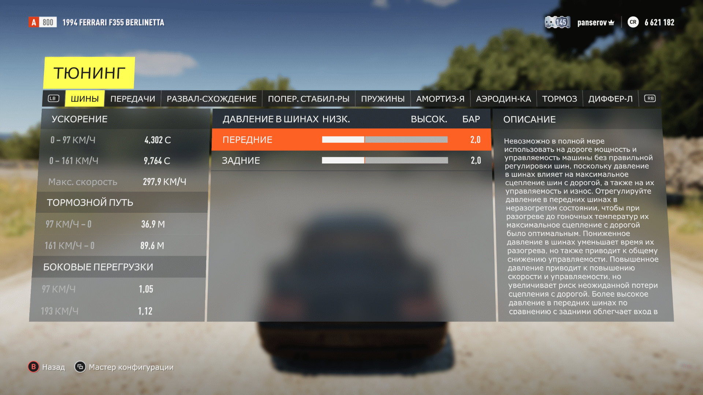
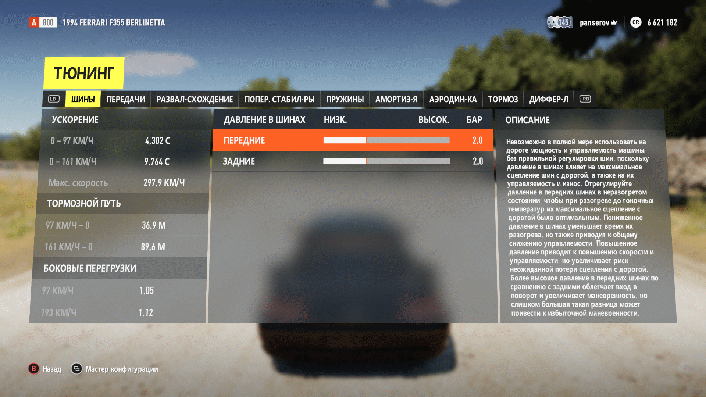

# Better cyrillic font for Forza Horizon 2
Улучшенный кириллический шрифт для Forza Horizon 2, формы глифов взяты из Forza Horizon 6 и сконвертированы при помощи ChatGPT. Доводка метрик проводилась вручную, чтобы отступы были больше похожи на те, что используются в латинице в игре.

Пример оригинального шрифта


Пример изменённого шрифта


# Установка `verdana.vfont` в Forza Horizon 2 через Azimuth

## 1. Как работает подмена

В конфигурации шрифтов FH2 `verdana.vfont` указан как fallback-шрифт для русского текста. Если основные шрифты интерфейса `Anthem_A.vfont` не содержат нужного кириллического символа, игра обращается к `verdana.vfont`. Изначально, все шрифты, используемые игрой, хранятся в `\Anthem_1.0.0.64_x64__8wekyb3d8bbwe\Mount\media\ui\fonts.zip`, однако при проведении какой-либо модификации этого архива, Azimuth ругается на ошибку проверки контрольной суммы файлов, следовательно прямая замена невозможна. Для проведения подмены необходимо установить модификацию `FH2 Extra Options`.

Для подмены шрифта используется каталог переопределения:

```text
Mount\mediaoverride\
```

Файлы в `mediaoverride` имеют приоритет над оригинальными ресурсами игры. Поэтому модифицированный файл можно положить в соответствующую подпапку, не перепаковывая `Fonts.zip`.

## 2. Что понадобится

- Рабочая установка Forza Horizon 2 версии `1.0.0.64`.
- Azimuth, через который запускается именно эта установка игры.
- FH2 Extra Options с включённой поддержкой media overrides.
- Подготовленный файл с точным именем `verdana.vfont`.

**Важно:** если у вас несколько копий игры или несколько папок Azimuth, используйте ту папку игры, которую фактически запускает выбранный `azimuth.exe`.

## 3. Найдите папку игры

Откройте папку Forza Horizon 2. В корне должны находиться, среди прочего:

```text
Anthem_1.0.0.64_x64__8wekyb3d8bbwe\
├── era.vbi
├── EmbeddedXvd\
└── Mount\
```

Далее все пути в инструкции указаны относительно этой папки.

## 4. Проверьте поддержку media overrides

Откройте файл `FH2_ExtraOptions.ini` рядом с `azimuth.exe`.

В секции `[Files]` проверьте параметр:

```ini
EnableMediaOverrides=1
```

Если параметр установлен в `0`, измените его на `1` и сохраните файл. Если параметр уже равен `1`, ничего менять не нужно.

Если у вас нет `FH2_ExtraOptions.ini` или соответствующего компонента Extra Options, не создавайте конфигурацию наугад: сначала установите совместимую с вашей версией Azimuth сборку FH2 Extra Options и следуйте её инструкции.

## 5. Установите шрифт

В папке игры создайте следующую структуру каталогов, если её ещё нет:

```text
Mount\mediaoverride\ui\Fonts\
```

И скопируйте туда модифицированный файл. Итоговый полный путь должен выглядеть так:

```text
<папка FH2>\Mount\mediaoverride\ui\Fonts\verdana.vfont
```

## 6. Как вернуть оригинальный шрифт

1. Закройте Azimuth.
2. Удалите только файл:

   ```text
   Mount\mediaoverride\ui\Fonts\verdana.vfont
   ```

3. Если после этого папки `Fonts`, `ui`, `mediaoverride` пусты, их можно удалить.

После удаления игра должна снова использовать оригинальный `verdana.vfont` из `Fonts.zip`.


## Примечания и источники

- FH2 Mods — сведения о FH2 Extra Options и параметре `EnableMediaOverrides`: https://github.com/conner-mcvay/fh2-mods
- FH2 Mod Platform — описание механизма загрузки модификаций в Azimuth: https://fh2mods.com/developers/docs
